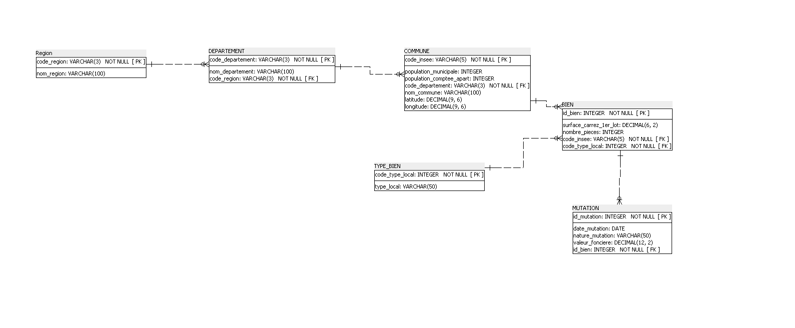

[Français](README.md) | **English**

# Real Estate Relational Database & SQL Analytics (Laplace Immo)

## At a glance

Laplace Immo, a network of real estate agencies, wants to steer its growth using public data. I designed a relational database from three open data sources (property transactions, census, geographic reference), in line with GDPR, then answered 12 business questions in SQL covering the first half of 2020.

- **Tools:** SQLite, DB Browser for SQLite, SQL
- **Volume:** 34,169 transactions, 38,916 municipalities
- **Deliverables:** 3NF schema, SQL scripts, results presentation ([EN](presentation_laplace_immo_en.pptx) · [FR](presentation_laplace_immo.pptx))

---

## Data modelling

The database is normalised to **third normal form**: each piece of information is stored only once, and tables are linked by foreign keys.

| Table | Rows | Content |
|---|---:|---|
| `REGION` | 19 | Regions, including overseas |
| `DEPARTEMENT` | 109 | Departments |
| `COMMUNE` | 38,916 | Municipalities, GPS coordinates, INSEE population |
| `TYPE_BIEN` | 2 | Apartment, House |
| `BIEN` | 34,169 | Carrez floor area, number of rooms |
| `MUTATION` | 34,169 | Sale date, transaction type and sale price |



Design choices:
- **`TYPE_BIEN` table** so the property type label is not repeated on every row.
- **Rebuilt INSEE code** by concatenating department and municipality codes, giving a unique and reliable join key.
- **Surrogate keys** (`id_bien`, `id_mutation`) created because the source data had none.

## GDPR & data quality

- **Data minimisation:** the buyer's name, a personal identifier not needed for the analysis, is removed before import.
- **Load checks:** `BIEN` and `MUTATION` each hold 34,169 rows (no data loss), and integrity is verified on every foreign key.
- **Reliable calculations:** filters `valeur_fonciere > 0` and `surface_carrez_1er_lot > 0`.
- **Known limitation:** SQLite has no native `DATE` type; dates are stored as text and split with `SUBSTR()`.

## Key findings

| Finding | Key figure | Query |
|---|---|---|
| A V-shaped half-year: April slump (first COVID lockdown), May–June rebound | –59% sales in April vs January; +3.7% from Q1 to Q2 | 7 |
| The Paris region dominates apartment sales | 45% of sales (13,989 out of 31,362) | 1, 2 |
| The market is driven by 2 and 3-room flats | 60% of sales; a m² in a 3-room flat is 12.4% cheaper than in a 2-room flat | 3, 10 |
| Paris far above the rest of the country | €12,053/m² 2.5 times the dataset average | 4, 5 |
| Large apartments: widest regional gap | €8,770/m² in Île-de-France, 2.4 times the next region | 8 |

**A critical look at the data**
- **Query 11** (top 3 most expensive municipalities per department, using `ROW_NUMBER()`): 6 of the 15 ranked municipalities have only one or two sales. A minimum sales threshold would make the ranking more robust.
- **Query 6** (most expensive apartments): it surfaces a 9 m² studio sold for €9M. In DVF, the sale price covers the whole transaction (often several lots), while the area only covers the first lot. Reliable price-per-m² figures would require excluding multi-lot sales and using the median.

## SQL techniques used

Joins across up to 6 tables, `GROUP BY` / `HAVING`, conditional aggregation (`CASE WHEN`), CTEs (`WITH`), window functions (`ROW_NUMBER()`, `SUM() OVER`), ratios and growth rates.

Example, query 11: top 3 municipalities by average sale price in 5 departments.

```sql
WITH RankedMunicipalities AS (
    SELECT
        d.code_departement AS department_code,
        c.nom_commune AS municipality,
        ROUND(AVG(m.valeur_fonciere), 2) AS avg_property_value,
        ROW_NUMBER() OVER (
            PARTITION BY d.code_departement
            ORDER BY AVG(m.valeur_fonciere) DESC
        ) AS ranking
    FROM MUTATION m
    JOIN BIEN b USING(id_bien)
    JOIN COMMUNE c USING(code_insee)
    JOIN DEPARTEMENT d USING(code_departement)
    WHERE d.code_departement IN ('6', '13', '33', '59', '69')
      AND m.valeur_fonciere > 0
    GROUP BY d.code_departement, c.code_insee, c.nom_commune
)
SELECT department_code, municipality, avg_property_value
FROM RankedMunicipalities
WHERE ranking <= 3
ORDER BY department_code ASC, avg_property_value DESC;
```

## Repository contents

| File | Description |
|---|---|
| `01_create_tables.sql` | Table creation (DDL) |
| `02_business_queries.sql` | The 12 business queries |
| `schema_erd.png` | Entity-relationship diagram (3NF) |
| `presentation_laplace_immo.pptx` | Results presentation (French) |
| `presentation_laplace_immo_en.pptx` | Results presentation (English) |
| `README.md` / `README.en.md` | Documentation in French / English |

---

Project completed as part of the OpenClassrooms Data Analyst program.
