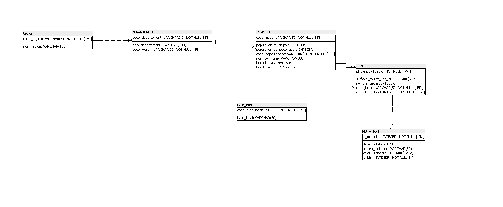

# Real Estate Relational Database & SQL Analytics (Laplace Immo)

## 📌 Executive Summary
This project focuses on designing and implementing a relational database from scratch for **Laplace Immo**, a real estate company. The objective was to consolidate fragmented public datasets (transactions, demographic records, geographic hierarchies), ensure **GDPR compliance**, and deliver strategic business insights via advanced SQL queries.

---

## 🏗️ Architecture & Database Modeling
- **Normalization:** Fully normalized database adhering to the **Third Normal Form (3NF)** to eliminate data redundancy and maintain integrity across 6 entities.
- **Relational Schema (ERD):**
  - `REGION` (19 regions)
  - `DEPARTEMENT` (109 departments)
  - `COMMUNE` (38,916 municipalities, enriched with INSEE population records)
  - `TYPE_BIEN` (property categories)
  - `BIEN` (34,169 property specifications)
  - `MUTATION` (34,169 sales transactions)
- **Engine:** SQLite environment.



---

## 🔒 Data Governance & GDPR Compliance
- **Anonymization:** Identification and immediate purging of sensitive personal identifiers (buyer full names) prior to database insertion.
- **Data Integrity:** Enforced referential integrity via Foreign Keys, validation checks (`valeur_fonciere > 0`, non-null geographic codes), and consistency audits across transaction counts.

---

## 📊 Key SQL Queries & Strategic Insights

The analytical script (`02_business_queries.sql`) answers 12 core business questions using Common Table Expressions (CTEs), Window Functions, and multi-table joins:

### 1. Market Top Tiers (Window Functions)
Identified top 3 municipalities by average real estate property value across targeted departments (`06`, `13`, `33`, `59`, `69`):
```sql
WITH RankedMunicipalities AS (
    SELECT 
        d.code_departement AS department_code,
        c.nom_commune AS municipality,
        ROUND(AVG(m.valeur_fonciere), 2) AS avg_property_value,
        ROW_NUMBER() OVER (
            PARTITION BY d.code_departement 
            ORDER BY AVG(m.valeur_fonciere) DESC
        ) AS ranking
    FROM MUTATION m
    JOIN BIEN b USING(id_bien)
    JOIN COMMUNE c USING(code_insee)
    JOIN DEPARTEMENT d USING(code_departement)
    WHERE d.code_departement IN ('6', '13', '33', '59', '69')
      AND m.valeur_fonciere > 0
    GROUP BY d.code_departement, c.code_insee, c.nom_commune
)
SELECT department_code, municipality, avg_property_value
FROM RankedMunicipalities
WHERE ranking <= 3
ORDER BY department_code ASC, avg_property_value DESC;
```

2. High Transaction Volume Areas
Filtered municipalities recording over 50 property sales during Q1 2020 using multi-joins and HAVING clauses.

3. Quarterly Market Growth
Computed quarter-over-quarter transaction evolution between Q1 and Q2 2020 (+3.68% overall sales activity) using conditional aggregations.

📁 Repository Structure

01_create_tables.sql : Database schema and table definitions (DDL)

02_business_queries.sql : Analytical SQL queries answering 12 business questions

schema_erd.png : Entity-Relationship Diagram (3NF)

presentation_laplace_immo.pptx : Stakeholder presentation deck

README.md : Project overview and documentation
