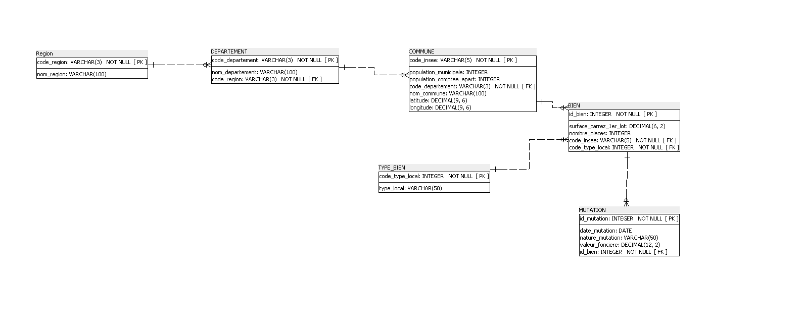

**Français** | [English](README.en.md)

# Base de données immobilière et analyse SQL (Laplace Immo)

## En bref

Laplace Immo, réseau d'agences immobilières, veut piloter son développement à partir de données publiques. J'ai conçu une base de données relationnelle à partir de trois sources ouvertes (transactions immobilières, recensement, référentiel géographique), en respectant le RGPD, puis répondu à 12 questions métier en SQL sur le 1er semestre 2020.

- **Outils :** SQLite, DB Browser for SQLite, SQL
- **Volume :** 34 169 transactions, 38 916 communes
- **Livrables :** schéma en 3NF, scripts SQL, présentation des résultats ([FR](presentation_laplace_immo.pptx) · [EN](presentation_laplace_immo_en.pptx))

---

## Modélisation

Base normalisée en **3e forme normale** : chaque information n'est stockée qu'une seule fois, et les tables sont reliées par des clés étrangères.

| Table | Lignes | Contenu |
|---|---:|---|
| `REGION` | 19 | Régions, dont outre-mer |
| `DEPARTEMENT` | 109 | Départements |
| `COMMUNE` | 38 916 | Communes, coordonnées GPS, populations INSEE |
| `TYPE_BIEN` | 2 | Appartement, Maison |
| `BIEN` | 34 169 | Surface Carrez, nombre de pièces |
| `MUTATION` | 34 169 | Date, nature et valeur foncière de la vente |



Choix de conception :
- **Table `TYPE_BIEN`** pour ne pas répéter le libellé du type de bien sur chaque ligne.
- **Code INSEE reconstruit** en concaténant code département et code commune, pour une clé de jointure unique et fiable.
- **Clés techniques** (`id_bien`, `id_mutation`) créées car absentes des données sources.

## RGPD et qualité des données

- **Minimisation :** le nom de l'acquéreur, donnée personnelle inutile à l'analyse, est supprimé avant l'import.
- **Contrôles de chargement :** `BIEN` et `MUTATION` comptent chacune 34 169 lignes (aucune perte), intégrité vérifiée sur chaque clé étrangère.
- **Fiabilité des calculs :** filtres `valeur_fonciere > 0` et `surface_carrez_1er_lot > 0`.
- **Limite connue :** SQLite n'a pas de type `DATE` natif ; les dates sont stockées en texte et découpées avec `SUBSTR()`.

## Principaux enseignements

| Constat | Chiffre clé | Requête |
|---|---|---|
| Un semestre en V : creux en avril (1er confinement), rebond en mai-juin | –59 % de ventes en avril vs janvier ; +3,7 % du T1 au T2 | 7 |
| L'Île-de-France concentre l'essentiel des ventes d'appartements | 45 % des ventes (13 989 sur 31 362) | 1, 2 |
| Le marché se joue sur les T2 et T3 | 60 % des ventes ; le m² d'un T3 est 12,4 % moins cher que celui d'un T2 | 3, 10 |
| Paris très au-dessus du reste du pays | 12 053 €/m², soit 2,5 fois la moyenne de l'échantillon | 4, 5 |
| Grands appartements : écart maximal entre régions | 8 770 €/m² en Île-de-France, 2,4 fois la région suivante | 8 |

**Regard critique sur les données**
- **Requête 11** (top 3 des communes les plus chères par département, avec `ROW_NUMBER()`) : 6 des 15 communes classées n'ont qu'une ou deux ventes. Un seuil minimal de ventes rendrait le classement plus robuste.
- **Requête 6** (appartements les plus chers) : on y trouve un 1 pièce de 9 m² vendu 9 M€. Dans DVF, la valeur foncière couvre toute la vente (souvent plusieurs lots) alors que la surface ne concerne que le 1er lot. Pour des prix au m² fiables, il faudrait écarter ces ventes multi-lots et privilégier la médiane.

## Techniques SQL utilisées

Jointures jusqu'à 6 tables, `GROUP BY` / `HAVING`, agrégations conditionnelles (`CASE WHEN`), CTE (`WITH`), fonctions de fenêtre (`ROW_NUMBER()`, `SUM() OVER`), ratios et taux d'évolution.

Exemple, requête 11 : top 3 des communes par valeur foncière moyenne dans 5 départements.

```sql
WITH RankedMunicipalities AS (
    SELECT
        d.code_departement AS department_code,
        c.nom_commune AS municipality,
        ROUND(AVG(m.valeur_fonciere), 2) AS avg_property_value,
        ROW_NUMBER() OVER (
            PARTITION BY d.code_departement
            ORDER BY AVG(m.valeur_fonciere) DESC
        ) AS ranking
    FROM MUTATION m
    JOIN BIEN b USING(id_bien)
    JOIN COMMUNE c USING(code_insee)
    JOIN DEPARTEMENT d USING(code_departement)
    WHERE d.code_departement IN ('6', '13', '33', '59', '69')
      AND m.valeur_fonciere > 0
    GROUP BY d.code_departement, c.code_insee, c.nom_commune
)
SELECT department_code, municipality, avg_property_value
FROM RankedMunicipalities
WHERE ranking <= 3
ORDER BY department_code ASC, avg_property_value DESC;
```

## Contenu du dépôt

| Fichier | Description |
|---|---|
| `01_create_tables.sql` | Création des tables (DDL) |
| `02_business_queries.sql` | Les 12 requêtes métier |
| `schema_erd.png` | Schéma entité-relation (3NF) |
| `presentation_laplace_immo.pptx` | Présentation des résultats (français) |
| `presentation_laplace_immo_en.pptx` | Présentation des résultats (anglais) |
| `README.md` / `README.en.md` | Documentation en français / en anglais |

---

Projet réalisé dans le cadre de la formation Data Analyst d'OpenClassrooms.
